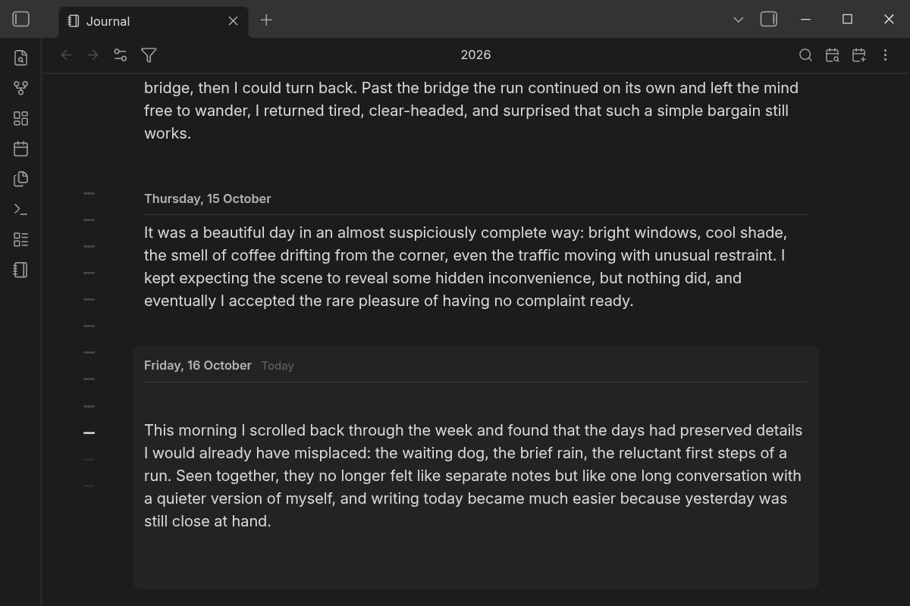

# Journal View

Give your daily notes a sense of continuity. Journal View brings them together in one scrollable,
editable timeline, so revisiting the past and writing today feel like part of the same story.

  

Open Journal View from the sidebar or run **Open journal** from the command palette.

- **Use the daily notes you already have.** Journal View works with your existing notes and daily-note
  settings—no plugin-specific formats, duplicate files, or lock-in.
- **Navigate and edit in one place.** Scroll through your journal, jump to any date, or return to
  today in one click, and read and write without switching between files, views, or editing modes.
- **Rediscover past entries.** Search across your journal to find notes, ideas, and memories from any
  day, revisit a random past day, and see how much you have written over the years in statistics.
- **Focus the timeline.** Filter daily notes by tags or property values, with include and exclude
  rules.
- **See what else each day held.** Optionally list the files you created or edited on each day,
  alongside that day's note.
- **Stay responsive across years of notes.** Journal View keeps the days around you ready to edit
  while efficiently handling the rest of your timeline.

## Learn more

The [guide](https://github.com/RUverse/journal-view/blob/main/docs/guide.md) covers each part of Journal View in detail:

- [Navigation](https://github.com/RUverse/journal-view/blob/main/docs/guide.md#navigation): going to a date, a random entry, and the date commands
- [Settings](https://github.com/RUverse/journal-view/blob/main/docs/guide.md#settings): every option and its default
- [Several notes a day](https://github.com/RUverse/journal-view/blob/main/docs/guide.md#several-notes-a-day): notes with text or a time after the date
- [File modification history](https://github.com/RUverse/journal-view/blob/main/docs/guide.md#file-modification-history): the files listed under each day
- [Filters](https://github.com/RUverse/journal-view/blob/main/docs/guide.md#filters): tag and property rules
- [Statistics](https://github.com/RUverse/journal-view/blob/main/docs/guide.md#statistics): the year mosaic and new words
- [Startup](https://github.com/RUverse/journal-view/blob/main/docs/guide.md#startup): opening the journal when Obsidian starts

## Privacy

Journal View works locally with files in your Obsidian vault. It does not make network requests,
collect telemetry, require an account, or access files outside your vault.

## License

[MIT](LICENSE) © 2026 RUverse
