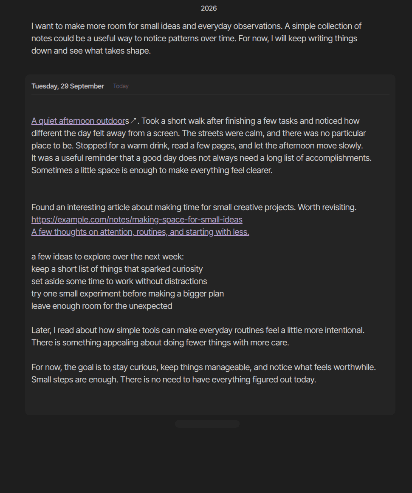
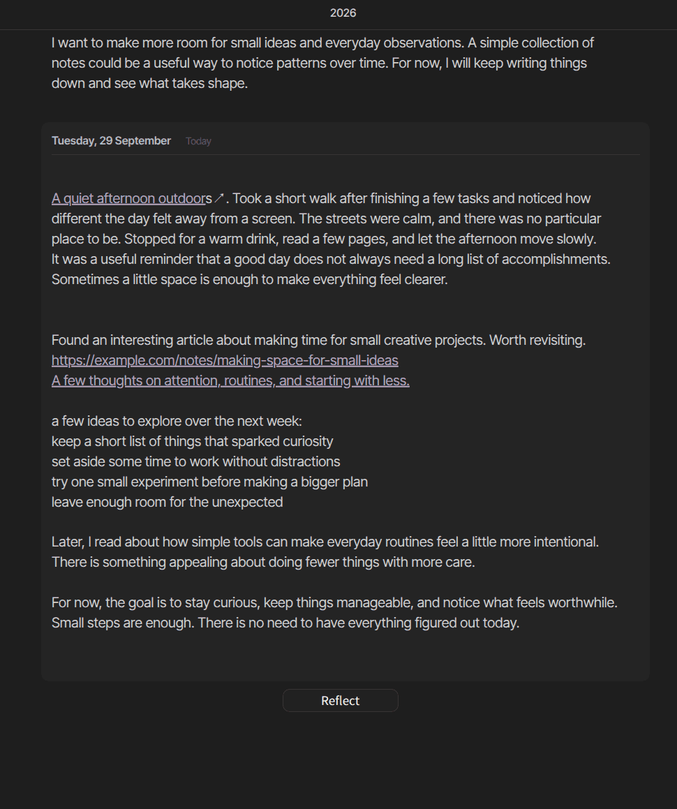
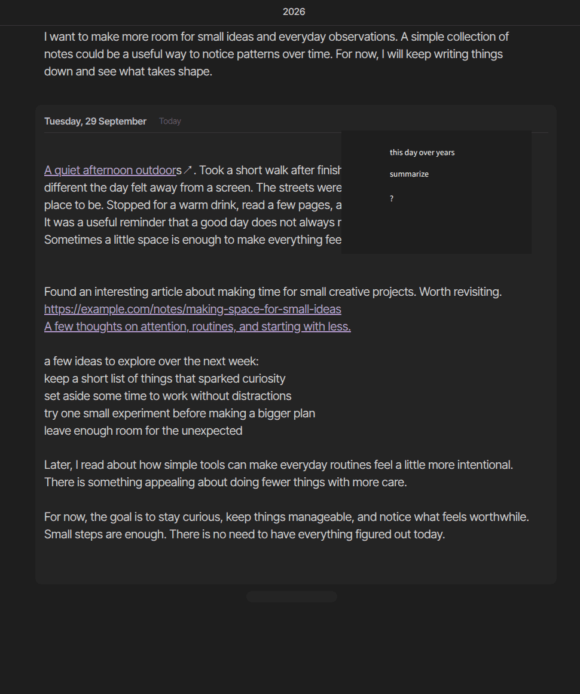
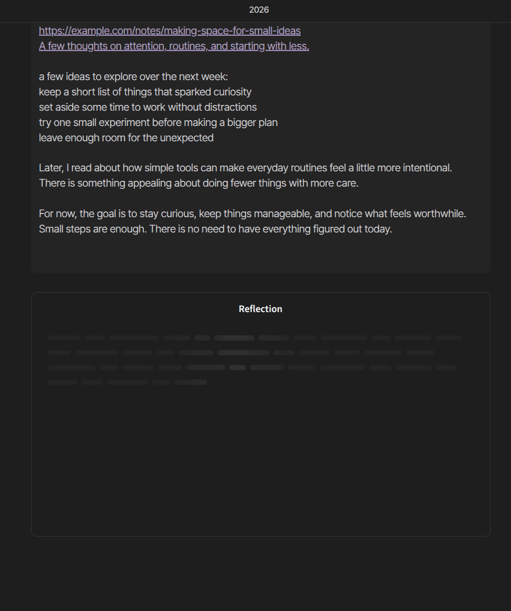
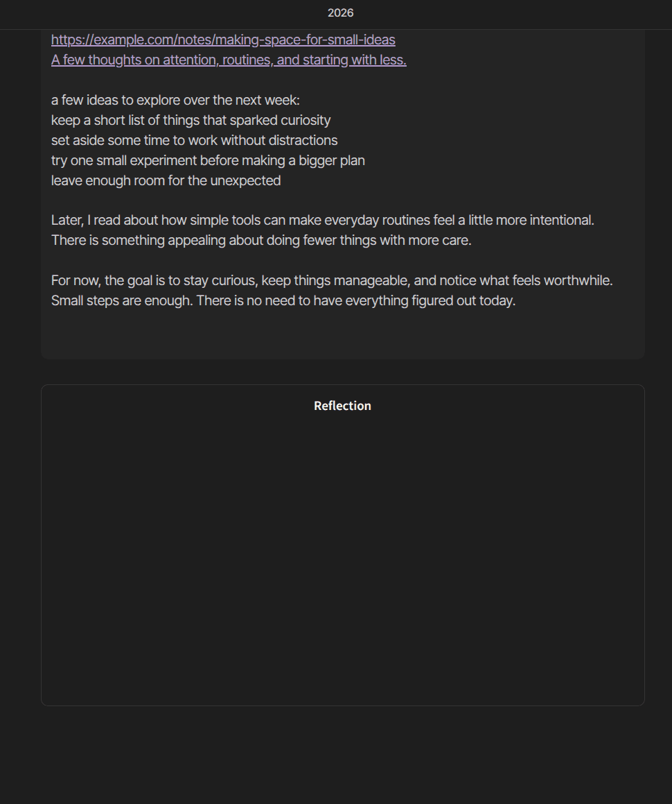

# Reflection: feature plan

Planned 2026-10-19; every step was built by 2026-10-27 and awaits review. On 2026-11-10 the ranges
a reflection used to be given went: the model finds the notes every question is about
([step 6](#6-every-reflection-finds-its-own-notes)), and the sections below describe that design.
This is a working plan for contributors, not user documentation: once the feature lands, its
behavior belongs in [the guide](../guide.md).

Reflection lets a local model read the journal and write back something worth reading: what you
learned over the last two weeks, what this date looked like in past years, plans that went quiet.
The reflection is saved as a note and shown on the day it was made, inside a bordered card that sets
it apart from what you wrote yourself.

The repository's [AGENTS.md](../../AGENTS.md) still applies: the work happens on the
`feature/reflection` branch and lands through its one pull request into `dev`. Run
`npm run typecheck`, `npm run lint` and `npm run build`, and verify in the test vault.

## Contents

- [Design drafts](#design-drafts)
- [Decisions](#decisions)
- [What the user sees](#what-the-user-sees)
- [Presets](#presets)
- [Architecture](#architecture)
- [Reflection files](#reflection-files)
- [Context and tools](#context-and-tools)
- [Order of work](#order-of-work)
- [Testing with Ollama on a Mac](#testing-with-ollama-on-a-mac)
- [Risks](#risks)
- [Defaults assumed](#defaults-assumed)

## Design drafts

The drafts are in the Penpot file *Journal View*, on the boards named *Reflections — …*. These crops
show the journal column of each:

| Resting | Hovered | Preset menu (sketch) | Generating | Ready |
| --- | --- | --- | --- | --- |
|  |  |  |  |  |

1. **Resting:** a faint pill below today's card.
2. **Hovered:** the pill grows into a **Reflect** button. Since 2026-10-30, an icon button in
   today's card replaces the pill; see [The button](#the-button).
3. **Preset menu:** a rough sketch of a short list of presets (*this day over years*, *summarize*,
   *?*). The Reflect window below replaces it.
4. **Generating:** a card with a thin border and no fill, titled **Reflection**, with skeleton lines.
5. **Ready:** the same card; its body is left empty in the draft.

## Decisions

Agreed with the user on 2026-10-19:

| Topic | Decision | Why |
| --- | --- | --- |
| Context | The model finds the notes itself, through tools, for presets and questions alike; a preset's question says what it is about ("the last two weeks"). Decided 2026-11-10. Until then presets fixed their own range, and a question came with a picker of what to read | Choosing a range was effort the question already made unnecessary, and a fixed range cannot follow a question about a person or a subject |
| Models | A model has to support tools, and the feature is tuned and judged on models of about 26B parameters and up. Decided 2026-11-10 | Smaller models chose and read notes too unreliably to be worth supporting |
| Search | Ranked keyword search, without embeddings. Decided 2026-11-10 | It needs no second model or index on disk, and the model can try other words for the same thing |
| Storage | One Markdown note per reflection in a configurable `Reflections` folder | Searchable, linkable, and kept without the plugin; no lock-in |
| Composer | The button opens the Reflect window: a question of your own, and the presets below it, each a click away. Changed from a menu on 2026-10-20 | A question of your own belongs next to the presets, not behind a menu item |
| Settings | Server, model, folder, context and presets live on the window's settings page; the plugin's tab keeps one **Reflections** toggle. Decided 2026-10-20 | The settings sit where they are used |
| Days | A day with reflections stays in the journal when it has no note, even with **Only show days that have a note** on. Decided 2026-10-20 | A reflection made yesterday must not vanish because yesterday had no note |
| Card | Read-only Markdown with linked source dates, **Regenerate**, **Ask a follow-up**, and **Delete** | Lets the reader check a reflection against what they wrote and keep talking to it |
| Generating | The drafted skeleton until the first words arrive, then streamed text with **Stop** | A local model reading two weeks of notes can take 30 s or more |
| Newest first | The stack flips: reflections (newest first), then the day's card. Until 2026-10-30 the button flipped with it, at the far end | Reflections keep to the journal's order, as the days do |
| Provider | Ollama only, behind a provider interface | Room for LM Studio or llama.cpp later without key storage now |
| Platform | Desktop only for now: hidden on mobile, `isDesktopOnly` stays `false` | Ollama usually runs on the same computer as Obsidian |

## What the user sees

### The button

- An icon button (`mirror-rectangular`, tooltip *Reflect on your notes*) in today's header, among
  the buttons of the note beneath it: left of **Open note in a tab**, or of **Create note** while
  today has no note. It shows with **Open note in a tab**, while that note is hovered or written in,
  and keyboard focus reaches it.
- It belongs to the day, not the note: it stays in the header when the lead note changes, and a
  further note's own buttons never carry it. Desktop only (`Platform.isDesktop`), and only while
  **Reflections** is on.
- Changed on 2026-10-30. Until then today had a handle outside its card: a faint pill below it
  (above it, newest first) that grew into a **Reflect** label on hover, as drafted above. For a
  while that day it sat at the card's bottom right, beside **Add a note to today**.

### The Reflect window

Selecting **Reflect** opens a modal titled **Reflect**, as **Customization** is opened from the
toolbar. The **Create reflection** command opens the same window. A gear at the top right turns the
window into its settings page, and an arrow leads back.

```text
Reflect                                  gemma4:26b  ⚙  ✕
┌──────────────────────────────────────────────────────┐
│ Ask your journal a question…                         │
└──────────────────────────────────────────────────────┘
The model finds the notes itself: name a time,   🔖 [Reflect]
a person or a subject.

Presets
This day over the years
Look at what I wrote on this date in earlier years, and …
What I learned
What did I learn or realize over the last two weeks?
…
```

- **Question:** a text box; Enter asks, Shift+Enter starts a new line. What was typed is kept while
  the plugin runs, so closing the window by accident loses nothing. The question says which notes it
  is about, and the model finds them; until 2026-11-10 a picker beside it chose what to read (*Let
  the model choose*, *Last 7 / 14 / 30 / 90 days*, *This day over the years*, *Dates…*).
- **Model:** shown quietly beside the gear, and chosen only on the settings page (changed on
  2026-10-27; the window had its own picker). While Ollama does not answer, or the chosen model is
  not installed or cannot use tools, a red warning icon comes before the name, its tooltip says why,
  and the setup box above the question says what to do. Selecting the name opens the settings.
- **Presets:** run at a click, each showing the question it asks. The bookmark button saves the
  typed question as a new preset.
- Until Ollama answers with a model that can use tools, the window says so above the question, with
  the setup steps: install Ollama, pull a model (`gemma4:26b`, with 32 GB of memory or more),
  **Try again**.

The settings page holds the server address and the connection's status, the model, the folder,
**Maximum context**, and the presets: reorder, edit, delete, **New preset**, and **Restore built-in
presets**, which brings back edited and deleted ones and keeps the reader's own. A preset's editor
has its name, question and an optional answer shape. Models that cannot use tools are listed in the
model picker, but cannot be chosen. The plugin's settings tab keeps
a single **Reflections** toggle, which turns the whole feature off: the button, the command, the cards,
and the days kept for their reflections.

### The card

States, in order:

1. **Reading:** the card appears next to the button with the drafted skeleton and a status line
   for each tool call as it happens: `Searching for "running"`, `Reading 5 Oct – 19 Oct`.
2. **Writing:** the first words replace the skeleton and the text streams in. **Stop** keeps what has
   been written so far.
3. **Ready:** the reflection renders as Markdown, read-only.
   - Cited dates such as `[[2026-10-05]]` move the journal to that day instead of opening the file.
   - A footer reads `From 9 notes · 5–19 Oct` and expands into date chips that do the same.
   - Top right, matching a note's header buttons: **Regenerate**, **Delete**, and **Open note in a
     tab**. As on a note, Open shows while the card is hovered, and the other two only while its
     header is (changed on 2026-10-27; all three showed on card hover, without Open).
   - At the bottom, an **Ask a follow-up…** box continues the same conversation inside the card.
4. **Error:** Ollama stopped answering, the model is missing, or the notes did not fit. The card
   says what happened and offers **Retry**. Nothing is saved unless some text arrived.

The card is a box with a border and no fill, like the draft, so it never reads as a note. Generation
keeps running if the reader scrolls away or the day is unloaded; the card picks up the current text
when its day loads again.

## Presets

Each preset is a question that says which notes it is about, and an answer shape; the model finds
the notes as it does for any question. `BUILT_IN_PRESETS` in `presets.ts` holds the exact wording,
which `scripts/reflection-spike.mjs` runs as it is.

| Preset | Its question is about | Asks for, in this shape |
| --- | --- | --- |
| This day over the years | This date in earlier years, and today | A paragraph per note, starting with its link, then the first note's hopes set against today |
| What I learned | The last two weeks | One to three lessons as bullets, each in close to the note's own words, with its link |
| Week in review | The last seven days | **High points** and **Low points** as cited bullets, **Energy** day by day, and one question |
| Open loops | The 30 days up to yesterday | Each plan once, under **Still open** (where it was written) or **Followed up** (where it was) |
| Recurring themes | The last three months | Three to five topics, each with its first and last mention, saying when one stopped appearing |
| Questions to sit with | The last two weeks | Three numbered questions, each after an entry's link and what it says, about what it leaves open |

Open loops ends yesterday because the models list today's to-dos however they are told not to; a plan
written today is not an open loop yet.

The shared system prompt is what separates an insight from a horoscope:

- Ground every point in specific entries and cite them with the exact link given for each note.
- When the notes do not cover something, say so instead of filling the gap.
- No praise, no generic advice, no therapy-speak.
- Write to the reader in the second person, in the language their notes are written in.
- Keep it to about 150–300 words unless the prompt asks otherwise.

Small models stop following the system prompt a few thousand tokens later, so the question, its
answer shape and a short reminder are repeated after the notes, at the end of the tool results that
pass them: write to me as "you", cite only with the links in the headings, one date per link, use
only what the notes say, and no praise, advice or closing summary. Without it, and without the
preset's answer shape, 8B models cited nothing at all.

## Architecture

A new `src/reflection/` module. The view only creates the button and the cards; everything else
stays behind small host interfaces, as with the view's other collaborators.

| File | Responsibility |
| --- | --- |
| `provider.ts` | The provider interface: list models, report tool support, stream a chat with tools, cancel |
| `ollama.ts` | Ollama implementation. `/api/tags` and `/api/show` go through `requestUrl`; `/api/chat` streams with `fetch` and falls back to a non-streaming `requestUrl` |
| `context.ts` | Dates as the model reads them, notes as it is shown them, the token budget, and mending citations |
| `search.ts` | The index of the journal's words, and ranked search over it with excerpts |
| `tools.ts` | The tools a model reads the journal with, what each returns, and the bounded loop that runs them |
| `journal.ts` | The vault's journal, as `tools.ts` reads it: the notes the filters let through, and their text |
| `presets.ts` | Built-in presets, and merging them with the user's |
| `store.ts` | Indexes the Reflections folder by date, follows vault events, creates, rewrites and trashes reflection files |
| `card.ts` | The bordered card: skeleton, streaming, Stop, Regenerate, follow-ups, sources, errors |
| `conversation.ts` | A reflection's follow-ups as its note keeps them, read back into a conversation |
| `modal.ts` | The Reflect window: the question, the presets, and the settings page with the connection, the model and preset management |

`context.ts`, `search.ts`, `tools.ts` and `presets.ts` import nothing of Obsidian's at run time, so
the spike script bundles them as they are and runs them against local models: what is tuned there
is what ships.

Changes to existing code:

- `src/settings.ts`: the server address, default model, folder (default `Reflections`), maximum
  context size and presets (null until edited: the built-in ones), and **Reflections**, the one
  toggle the settings tab shows.
- `src/day.ts`: a reflections element on every day, placed by sort direction, and the Reflect
  button on today's card.
- `src/dayFiles.ts`: leave the Reflections folder out of file history, next to the template folders
  (`src/dayFiles.ts:229`).
- `src/main.ts`: create the store as a child component, like `FindCorpus`
  (`src/main.ts:101`), and add a **Create reflection** command that opens the Reflect window.
- `src/dayWalk.ts`: `ShownDays` counts the days with reflections, next to the days with files, so
  the walker keeps them when empty days are hidden; the view brings such a day in with its first
  reflection and hides it after its last.
- `README.md`: a feature bullet and a revised **Privacy** section. It currently promises no network
  requests; it must say that reflections send the notes they read to the Ollama server you configure,
  by default on this computer, and nowhere else.
- `docs/guide.md`: a *Reflections* section, once the feature is usable.

Notes are matched by folder and date format (`src/noteIndex.ts:245`), so files in a separate
Reflections folder cannot be taken for daily notes. Keep the folder outside the daily-notes folder by
default, and refuse a Reflections folder equal to it.

## Reflection files

One file per reflection: `Reflections/2026-10-19 What I learned.md`, then `… What I learned 1.md`
for a second one the same day. Custom prompts are named from the prompt's first words.

```yaml
---
journal-view: reflection
created: 2026-10-19T15:32
preset: what-i-learned
prompt: What did I learn or realize over the last two weeks?
model: gemma4:26b
from: 2026-10-05
to: 2026-10-19
sources: ["[[2026-10-05]]", "[[2026-10-09]]", "[[2026-10-14]]"]
---
```

- The body is the reflection. Each follow-up is appended as a plain quote of the question followed
  by its answer, which reads quietly in Obsidian and can be read back into a conversation:

  ```markdown
  > Say more about the second point

  The answer…
  ```

  An answer can quote the reader's notes the same way, so the questions are also listed, in order,
  in a `follow-ups` property; only a quote matching the next one starts a follow-up. Until
  2026-10-27 each question was a `> [!question]` callout instead, which still reads as one.

- The day a reflection belongs to is the date in `created`.
- `sources` are the notes passed to the model whole, and `from` and `to` the days they span. Until
  2026-11-10 a `scope` property recorded what Regenerate and follow-ups read again; it is no longer
  written, and Regenerate removes it.
- The file is written once the stream ends, or on **Stop** if some text arrived. Regenerate rewrites
  the body in place with `vault.process` once the new answer is complete, and asks first when there
  are follow-ups, which it clears; **Stop** or an error keeps the old answer. It then rewrites
  `model`, `from`, `to` and `sources` with `processFrontMatter`, and removes `follow-ups`.
  A follow-up adds its quote and answer to the end, its question to `follow-ups`, and its notes to
  `sources`, and widens `from` and `to`.
- Delete reuses the note flow: `fileManager.promptForDeletion`, then `trashFile`
  (`src/entry.ts:1321`).

## Context and tools

Every reflection reads the journal through tools, in a loop: the model calls one or more, reads
what they return, and calls again or answers. Step 6 has how this came about and how it scored.

| Tool | Returns |
| --- | --- |
| `search_journal(query, from?, to?)` | The notes that match words, a name or a phrase, ranked; see below for what it shows of them |
| `read_notes(dates)` | Chosen notes in full: the ones a search or a list showed that matter |
| `read_journal(from, to, tag?)` | Every note of a range of days in full, within the budget |
| `list_journal(from, to)` | One line a note: link, date, words, mood and tags, first words. By month past 120 notes |
| `on_this_day(date?)` | A date in every year, in full |

### What the model is shown

- Each note passed in full comes under a heading that carries its exact link:
  `### [[2026-10-05]] · Monday, 5 October`. The model is told to cite with those links, so citations
  resolve whatever the date format is.
- Below the heading goes one line of the note's properties, such as `mood: awful · tags: work`,
  leaving out empty values, values that nearly every note in the journal shares (`type: daily`, the
  tag `journal`), and values that restate the note's date. The YAML itself is not passed. Moods are
  the best signal *Week in review* has for energy, and stripping all properties lost them.
- The note's own headings are pushed below that `###`, so a `## Log` cannot read as a new note.
- The system message states today's date and the days the usual periods start on (`the last two
  weeks (14 days) began on 2026-10-06`), since models cannot count back from today, and how many
  notes the journal holds, from when to when.
- Dates in arguments are read leniently: `YYYY-MM-DD`, `today`, `yesterday`, `2 weeks ago`,
  `19 October`, a month (`2026-08`) or a year alone. Any other error says how to call again.
- Notes already passed are named rather than repeated.

### Search

`search.ts` indexes every note's words the first time a run searches, a batch at a time: about half
a second for 3,300 notes, after which a search takes a few milliseconds.

- **Matching.** Words are compared by their stems (`run` finds `running`), without case or accents.
  A longer word also finds the words that start with it, and those that share most of their start
  with it, so `reorganization` finds `reorganising` and `reorg`. A note's tags, properties and name
  count as its words. A word that the index does not hold as a word is looked for as text.
- **Queries**, as models write them: several words are looked for together, and a note with all of
  them ranks above one with some; commas, `OR` and `|` separate other ways of saying a thing; quotes
  keep words together, and fall back to the words apart when they stand together nowhere. A word in
  most of the notes (`to` in `trip to Lisbon`) is not searched for beside rarer ones.
- **Ranking** is BM25. When a query has several words, the result says how many notes each is in:
  a search for `trip to Lisbon` that finds a note about tripping says that no note mentions Lisbon.
- **What a search returns** depends on what it found:
  1. **The story.** When the days from the first mention to the last are few enough to read (60
     notes and 35% of the context at most), every note of those days is passed in full, and the
     ones that mention the subject named. What happened to a subject is as often in the days
     between, in notes that never name it: the reorganization's outcome is in a note that says
     only "Names, finally", which no search for it finds, and models asked to read on did not. When
     every mention's days are too many, the days of the notes that match best are tried, which
     leaves out a stray mention years away.
  2. **A handful.** Up to six notes too far apart for that are passed in full.
  3. **Excerpts.** Otherwise the 20 notes that match best, always with the first and the last
     mention, oldest first: each with its date, link, properties and the sentences around its
     matches, the spread of all the matches by month or year, and the `read_notes` call that reads
     the ones that matter.

### The loop

- Up to eight rounds with tools, then one request without them. `num_ctx` is the whole context
  limit from the first round, since changing it makes Ollama load the model again, and each tool
  result is cut to the room left, measured against `prompt_eval_count` as the rounds go. A search
  or a list takes 30% of the context at most, to leave the room to read in.
- **Budget:** tokens are estimated at about four characters each, plus 10%, since Gemma counted
  more. Scripts such as Persian or Chinese take more tokens per character; the first response's
  `prompt_eval_count` corrects the estimate. Without `num_ctx`, Ollama silently cuts prompts at its
  default context size.
- When the notes of a range do not fit, whole notes are dropped evenly across it, search hits last,
  and the dropped ones named as dates, so the model can read them by themselves.
- After a round that passed notes in full, the question, its answer shape and the reminder are
  repeated at the end of the results.
- **Two guards, each used once.** An answer written before any tool call is dropped unseen and the
  model told to look first: shown its own answer, a model goes looking for the notes it invented.
  An answer that leans on excerpts or a list alone is sent back to read in full. While either
  could fire the text is held back from the card; and when the answer would be sent back whatever
  it says, it is stopped after its first words rather than written out and dropped, which saved
  `gemma4:26b` three seconds a run.
- A follow-up is told which days the reflection's notes were on, since their text is not kept, and
  reads the ones it needs again or looks further.
- **Citations as written:** models sometimes put two dates in one link (`[[2024-10-19, 2025-10-19]]`)
  or write a bare `2026-10-05`. Before rendering, such links are split into one per date, and bare
  dates that match a note that was read are linked, unless their own link follows them. Dates that
  match no note stay plain text.

## Order of work

All steps land on `feature/reflection`, one or more commits each, and reach `dev` together through
the feature's single pull request. Merge the latest `dev` into the branch when it falls behind. Keep
the build passing after every step, so the branch can be tested at any point.

### 0. Spike: judge the reflections before building the UI

Done on 2026-10-19: see [The sample journal](#the-sample-journal) and [Results](#results) below.

The test vault's notes were filler (`word word word…`), useless for judging a reflection. Before any
UI:

1. Add a realistic sample journal to the test vault, dated relative to the day the script runs:
   about 90 days of short fictional entries before today, plus this date in each of the three
   previous years. Plant patterns to check the presets against:
   - a worry that recurs and slowly fades;
   - a habit started and then dropped;
   - two plans written once and never mentioned again;
   - one lesson stated plainly;
   - a person who comes up often.
2. Write a throwaway Node script that builds the context exactly as `context.ts` will and calls
   Ollama. Run every preset on two or three models and record, in this file:
   - whether it found the planted patterns;
   - whether its citations point at the right days;
   - how long it took.
3. Tune the presets and the system prompt until the results are worth reading.

The spike decides whether the presets are good, which the UI cannot fix later. Keep the sample
journal; the script can be dropped once `context.ts` exists.

#### The sample journal

The journal is now the test vault's own `Journal/`. `scripts/sample-journal.md` holds 66 entries
keyed by "days ago" and "years ago": 63 between 89 days ago and today, with ordinary gaps and one
5-day gap (43–39, a visit to the parents), and this date 1, 2 and 3 years ago. `npm run test-vault`
writes them the first time, and `npm run sample-journal` moves them up to today. The setup script's
fixtures moved to May 2026, before those 90 days.

The narrator is a product designer living alone; Mina is their younger sister, Theo a coworker and
friend, Dana their manager. Planted patterns, by days ago:

| Pattern | Where | A good reflection |
| --- | --- | --- |
| Worry that fades: a reorganization at work | Heavy 86–60 (9 entries), lighter 57–35, last at 24 ("hadn't thought about it in over a week") | Names it, and says it faded once names were announced at 51 |
| Habit dropped: morning runs | First run 80, 5 km at 62, sore knee 50, "I should get back to it" 45, then nothing | Notices the runs stopped after 45 |
| Two plans never mentioned again | 27: write to Mr. Farahani, an old art teacher. 15: build a hallway bookshelf | *Open loops* lists both |
| Decoys that were followed up | Bike brakes 22 → fixed 17; helping Mina move 19 → done 9; client presentation 13 → held 5 | *Open loops* leaves them out |
| A lesson stated plainly | 6: walking away for twenty minutes beats two hours of forcing a design | *What I learned* finds it, cited to 6 |
| A lesson left implicit | 11: Mina calms down once the narrator stops offering solutions and listens | A strong answer finds it; not required |
| A person who comes up often | Mina in 17 entries: flat hunt from 65, lease at 30, move at 9, dinner at hers at 3 | *Recurring themes* names her and her move |
| Private entry | 33, tagged `private`: a doctor's visit for headaches; 20: mostly gone after less coffee | Reads only when filters let it through |
| The last week | 6 good, 5 a bad client presentation, 4 tired, 3 dinner at Mina's, 2 steady, 1 drained but a good book, 0 calm | *Week in review* gets the high (3) and low (5) |
| This day over the years | 3 years: just moved, lonely, wants friends and meaningful work. 2: new job, likes Theo, Mina visits. 1: Mina has moved to the city, rent going up. Today: settled, Mina 10 minutes away | Traces loneliness to closeness, citing each year |

#### Results

Run on 2026-10-19 on an M5 Max with 128 GB, Ollama 0.40.6, through `scripts/reflection-spike.mjs`
as it was then: a copy of the prompt-building code, which handed each preset the notes of a fixed
range. [Step 6](#6-every-reflection-finds-its-own-notes) replaced both.
The prompts went through four rounds. Separate grading agents read every answer against the notes
and the key above, checking each claim and whether each cited note supports the sentence it is
attached to, and scored it from 1 (wrong or generic) to 5 (grounded, specific, accurate). One sample
can move a score by about a point, so the last round used two samples per model.

| Model | Memory once loaded | Short presets, last round | *Open loops* and *Recurring themes* | Time per preset | Verdict |
| --- | --- | --- | --- | --- | --- |
| `gemma4:26b` | ~18 GB resident | 4.4 | Open loops 5 in both samples; Recurring themes 3 | 1–9 s | Suggest with 32 GB or more |
| `qwen3.8:27b-mlx` | 23 GB | 3.75 | Open loops 5 in both samples; Recurring themes 4, the best | 3–25 s | The best at long ranges, wordier elsewhere; Apple silicon only |
| `gemma4:12b` | 15 GB | 4.75 | Files one open plan as followed up; Recurring themes 2–4 | 1–11 s | Only with 24 GB or more; little gain over 26b's memory |
| `gemma4:e4b` | 10 GB | 3.25 | Open loops 2–3, or 4–5 with thinking (6–8 s); Recurring themes 2 | 1–5 s | Suggest with 16 GB |
| `qwen3:8b` | 6 GB | 2.75 | 1.5; usable on Open loops only with thinking (25–29 s) | 2–9 s | Not suggested |
| `llama3.1:8b` | — | 2.0 (third round) | 2.7 | 3–10 s | Not suggested |
| `gemma3:4b` | — | 1.75 | 1.3; writes fiction | 2–10 s | Not suggested |

Memory is macOS's `footprint` for the runner process, or its resident size for `gemma4:26b`, whose
weights are mapped from the file. `ollama ps` is unreliable here: it reported 16 GB for `gemma4:12b`
and 1.2 GB for `gemma4:26b`. `gemma4:26b` is a mixture of experts with under 4B parameters active per
token, which is why it is as fast as the 8B models. Expect every time to be several times longer on
a machine without Apple Silicon or a GPU.

By preset, with the final wording:

- **This day over the years:** 4–5 on the Gemma 4 models once each paragraph kept to its own year.
  Smaller models still misread who was where, such as Mina's "you could live here".
- **What I learned:** both lessons, the stated and the implicit one, in every sample from
  `gemma4:12b` and `gemma4:26b`. Asking for "one to three bullets and nothing else" stopped the
  padding that "up to five" invited.
- **Week in review:** 4.4 on average. The mood line under each heading fixed the energy arc, which
  the models had misdated while properties were stripped.
- **Open loops:** ending the range yesterday removed today's to-dos, which no instruction did. The
  **Still open** / **Followed up** shape gave follow-ups somewhere to go; putting **Followed up**
  first backfired, filing open plans there as "None". The final wording, with **Still open** first
  and each plan under one heading, was checked by hand in two samples per Gemma 4 model rather than
  graded: right every time on `gemma4:26b`, while `gemma4:12b` and `gemma4:e4b` still filed the
  bookshelf under **Followed up** unless `gemma4:e4b` was thinking.
- **Recurring themes:** the weakest preset: 3 at best for every model but `qwen3.8:27b-mlx`, which
  scored 4 in both samples. The others read a walk on 13 October as the runs resuming, and rarely
  say a worry faded. Writing the cut-off date into the prompt helped a little,
  since models cannot count back from today. The two-pass digest scored no better for any model at
  five times the time, because its first pass dropped details such as the worry's last mention; it
  is not planned.
- **Questions to sit with:** quoting the entry before the question made models drop the question or
  ask about minor lines, so the final wording keeps the summary sentence first. It was checked by
  hand rather than graded.

What carries into the implementation:

- The answer shape and the reminder after the notes are what made small models cite at all; without
  them, 8B models cited nothing in most answers. Keep both in `presets.ts`.
- Enforce in code what the models ignore: the range that ends yesterday, the cut-off date written in.
- Temperature made no difference worth keeping; leave each model's default.
- Thinking stays off (see [Risks](#risks)). If `gemma4:e4b` turns out to be what most people run,
  thinking for *Open loops* alone is worth another look: 6–8 s there, and it fixed the misfiled plan.
- The first round changed the prompt wording as well as adding the answer shapes, so its gains are
  not the shapes' alone.

### 1. Reflection files and cards

- The `store.ts` index and the card in its ready state, on the right day in both orders.
- **Delete**, and leaving the folder out of file history.
- No network yet: verify with reflection files written by hand.

### 2. Ollama provider and context

- `provider.ts`, `ollama.ts` with streaming and its fallback, and `context.ts` with budgeting.
- The settings section with a **Test connection** button.
- The README Privacy change, since this is the first network use.

### 3. Reflect button and presets

- The handle, the menu (replaced by the Reflect window in step 4), and the built-in presets.
- The card's reading, writing, stopped and error states, and saving the file.

### 4. Modal and tools

- Custom prompts, the scope picker, `tools.ts` with its loop and fallback, and preset management.

Done on 2026-10-20, with the changes asked for that day: the window replaces the menu, its settings
page replaces the settings tab's section, and days with reflections stay in the journal.
`scripts/reflection-tools-spike.mjs` mirrored `tools.ts` over the sample journal, and tuned the
tools, the prompts and the loop. Its runs are in `test-vault/.reflection-spike/`. What follows is
how the tools stood then; [step 6](#6-every-reflection-finds-its-own-notes) rebuilt them, and
[Context and tools](#context-and-tools) describes them as they are.

#### The tools, as tuned

- `search_journal` matches the start of words with a light stemmer, so *run* finds *running*, and
  ends with the `read_journal` call that would read what it found. That one line is what got small
  models to read notes in full rather than answer from excerpts.
- `read_journal` names the notes it already showed rather than repeating them, drops whole notes
  evenly when they do not fit (search hits last), and names the dropped ones. A tag that matches
  nothing reads the whole range and lists the tags there: models take topics for tags.
- `list_journal` lists by month past 120 notes; `on_this_day` takes a date in any year.
- Arguments are checked, and every error says how to call again. A backwards range is swapped.
- Up to six rounds with tools, then one request without them. `num_ctx` is the whole context limit
  from the first round, since changing it makes Ollama load the model again, and each tool result is
  cut to the room left, measured against `prompt_eval_count` as the rounds go.
- **Two guards, each used once.** An answer written before any tool call is dropped unseen and the
  model told to look first: `qwen3:8b` invented whole notes in its first round for five of seven
  questions, and shown its own answer it went looking for the notes it had invented. An answer that
  leans on excerpts alone is sent back once to read in full. While either could fire, the text is
  held back and given to the card whole.
- `llama3.1` writes its calls into the text as JSON; those are taken as calls.

#### Results

Seven questions whose answers the sample journal plants (*When did I stop running, and why?*, Mina,
the reorg, this date in past years, the Farahani letter, what I learned, and the unanswerable *How did
my trip to Lisbon go?*), plus one with `#private` excluded, scored 1–5 against the answer key by two
grading agents:

| Model | Score | Time per question | Notes |
| --- | --- | --- | --- |
| `qwen3.8:27b-mlx` | 4.6 | 4–35 s | Several targeted searches and reads; checks nothing came later |
| `gemma4:26b` | 4.4 | 1–12 s | Sensible calls every time. Suggested |
| `gemma4:12b` | 4.1 | 3–15 s | Usable; sometimes loops on hidden markup after a tool result |
| `gemma4:e4b` | 3.0 | 0.2–13 s | Wrong dates and ranges at times; answers from lists |
| `qwen3:8b` | 3.3 | 5–33 s | Needs both guards; odd ranges |
| `llama3.1:8b` | 2.3 | 2–21 s | Garbage arguments, no links, invents. Unusable |
| `gemma3:4b` | — | — | The server refuses tools: the `no-tools` path, which reads the last 14 days |

Every model said the notes do not cover Lisbon. With `#private` excluded, `gemma4:26b` said the notes
do not record what the doctor said. The slips left: a detail cited to the note next to its own, and
no answer saying the runs never resumed. Gemma writes several citations as `[[a], [b]]`, which
`repairCitations` now splits.

### 5. Regenerate, follow-ups and sources

- Regenerate, the follow-up box and its quotes, the sources footer, and citations that move the
  journal.
- The guide section.

Done on 2026-10-27. A regenerate or a follow-up is a run in `runner.ts` that names the note it
writes back to; the day shows it inside that note's card rather than as a card of its own. Both ask
again as of the reflection's own day, with the window's current model:

- **Regenerate** rebuilds the request from the note: its `prompt`, and the format of its `preset`
  when it still exists (else the one for questions of your own). The card shows the skeleton and
  the new answer in place of the old one; a regenerate that fails shows the old answer again with
  the error above it.
- **Follow-ups** read the note's conversation back with `parseConversation`: it follows the first
  question, and the model looks through the journal again, since what it read before is not kept.
  Since step 6 it is told which days the reflection's `sources` were on, to read them again. The
  guard that drops an answer written before looking applies to follow-ups too. The question shows
  as its quote at the bottom of the card, with its own status line, **Stop**, and on failure **Try
  again** and **Dismiss**, which puts the question back in the box. Until step 6, a reflection over
  fixed notes was followed up over the same notes, passed again.
- The footer opens into a chip per source, sorted by date, that moves the journal there; a source
  no longer in the journal is a disabled chip. Ctrl/Cmd on a chip or a citation opens the note in a
  new tab.
- Deleting a reflection while a regenerate or follow-up runs cancels the run.
- **Scroll position.** The anchor pinned the day below a reflection being written, so the
  reflection grew upwards: its text climbed, and its Stop button slid away from the pointer, about
  130 px a second, so a real click (press and release on the same element) missed it. While a
  reflection being written is at least partly in view, `src/anchor.ts` now pins that reflection's
  top instead, and it grows downwards; out of view, the day below is pinned as before, so a note
  being read below a reflection streaming above it does not move. The card also draws its title,
  buttons and footer only when they change, rather than every frame while text streams in.

Tested in the test vault on `gemma4:26b`: a follow-up over fixed notes, then one with tools, which
listed and read 4 Sep – 20 Oct and said truthfully that the runs never resumed; Regenerate of *What
I learned* over the same 13 notes, which found both planted lessons; Regenerate with follow-ups,
cancelled at the question, then stopped part-way, leaving the note byte for byte as it was; a
follow-up against an unreachable server, retried and dismissed; a citation and a chip moving the
journal; and deleting a reflection while a follow-up to it ran. With mouse events sent through
the DevTools protocol, a press and release on Stop while a follow-up streamed stopped it and kept
the text so far. In both day orders a follow-up in view held still while it streamed, after one
step up as it replaced the box it was typed in; with the reflection streaming out of view above,
the note being read stayed where it was.

### 6. Every reflection finds its own notes

Asked for on 2026-11-10: the picker of what a question reads was effort the question already made
unnecessary, so it went, and the presets became questions that say what they are about. The model
finds the notes for all of them, and has more ways to: a ranked search with the sentences around
each match, and reading the notes it picks. A model has to support tools, and the work was tuned
and judged only on models of about 26B parameters and up.

What changed:

- **One path.** `buildContext`, the scopes, the window's picker, a preset's *Reads* and the
  14-day fallback are gone. `runner.ts` refuses a model without tools with a message saying so, and
  the window shows it before a run is started. While no model is chosen, `gemma4:26b` is used when
  it is installed.
- **The engine runs outside Obsidian.** `tools.ts`, `search.ts`, `context.ts` and `presets.ts` no
  longer touch the vault: `journal.ts` hands them the notes. `scripts/reflection-spike.mjs` bundles
  and runs them as they are, in place of two scripts that each kept a copy of the prompts and the
  tools by hand. It asks the questions below and the presets, takes a question of your own
  (`--ask`), and runs one tool without a model (`--call`), to see what a model would be shown.
- **Search** is ranked and reads queries as models write them; see
  [Context and tools](#context-and-tools). Before, it matched a query as one phrase, so `running
  knee` found only those two words side by side, showed the matches thinned evenly rather than the
  best ones, and the only way to read on was a whole range of days.
- **`read_notes`** opens chosen notes by date.
- **Dates.** The system message gives the days the usual periods start on, and arguments are read
  leniently.
- **Presets** carry their period in the question. *Open loops* asks about "the 30 days up to
  yesterday": worded as "the last 30 days… leave today out", `gemma4:26b` filed the bike's brakes
  under both headings in three runs of three. *Recurring themes* starts "Read my notes from the
  last three months": without that, `gemma4:26b` once guessed at themes with a search for ninety
  words instead of reading.

What the spike showed along the way, each of which changed the design:

- **A search for a subject misses how it ended.** Asked what happened with the reorg, both models
  searched, read the notes that matched, and `gemma4:26b` answered without the outcome: the note
  where the names are announced never uses the word. Told at the end of the results, twice, that
  the days between might say more, it still did not read them. So the search now passes those days
  itself when they are few enough, and the answer has the outcome every time.
- **Finding related notes by the words they share with the matches does not work** on a journal:
  with 70 notes the words shared by the best matches were `brought`, `right` and `were`. Not built.
- **Answers from excerpts.** `gemma4:26b` answers from a page of excerpts every time, however the
  results end, and is sent back to read. Stopping that answer after its first words, since it
  will be dropped whatever it says, took such runs from 13 s to 10 s.
- **`three months` is not `90 days`.** With the periods listed by their days alone,
  `qwen3.8:27b-mlx` read the last month for *Recurring themes*; they are now named both ways.

#### Results

Run on 2026-11-10 on the same machine, through `scripts/reflection-spike.mjs`: twelve questions
(the seven of step 4, the doctor's visit, and *When was I worried about money, and what did I do
about it?*, the bookshelf, *What did Theo and I do together over the last month?* and *What were
the best days of August?*) and the six presets, once each. A grading agent checked every claim and
citation against the notes and the answer key, and scored each answer from 1 to 5:

| Model | Questions | Presets | Rounds | Time per answer | Notes |
| --- | --- | --- | --- | --- | --- |
| `gemma4:26b` | 4.25 | 3.67 | 2, at most 4 | 1–10 s | Terse and reliable on lookups; drops the end of an arc, or a last-note link, when it has to sum up many notes |
| `qwen3.8:27b-mlx` | 4.25 | 3.83 | 2–4 | 3–32 s, and 52 and 96 s for two presets | Better at arcs, quotes the notes, says when they are silent; over-includes and embellishes small details |

Every citation in all 36 answers was to a note the model had read in full, and none to a note that
does not exist. Both said the notes do not cover Lisbon. Both gave the reorg's outcome, and both
planted lessons for *What I learned*. *Open loops* had both open plans and no decoy as open on
both models, though neither listed helping Mina move as followed up.

The slips left, none of them in finding the notes:

- **Misreadings.** `gemma4:26b` read "she's been here four months" as visits, and "everything is
  unpacked except the box marked MISC" as very little unpacked. `qwen3.8:27b-mlx` gave the narrator
  an argument that was Ines's and Theo's.
- ***Recurring themes*** is still the weakest preset: `gemma4:26b` had four of five last-mention
  links wrong, and `qwen3.8:27b-mlx` gave six themes for five.
- ***Questions to sit with*** was generic on `gemma4:26b` and built on premises the notes do not
  hold on `qwen3.8:27b-mlx`.
- **Leaked reasoning.** Twice `qwen3.8:27b-mlx` wrote its answer, then `</think>`, then the answer
  again. The loop now keeps only what follows `</think>`, and takes the draft back from the card.

The scores are about those of step 4 (4.4 and 4.6 on seven questions), on a wider set and with the
presets now finding their own notes: those had scored 4.4 and 3.75 on the short presets when the
notes were handed to them. One sample each, so a score can move by about a point.

Tested in the test vault on `gemma4:26b`, with the journal moved up to 10 November:

- The window has no picker and no date fields; each preset shows its question.
- *What happened with the reorg at work?*, typed and asked with the **Reflect** button, searched
  for `reorg`, `reorganization` and `work`, read 38 notes and gave the outcome. The note records no
  `scope`, 38 `sources`, and the days they span; its card's footer says the same.
- *What I learned*, from its preset, read 28 Oct – 10 Nov and found both lessons.
- A follow-up, *Who is Ines, and how is working with her going?*, searched for her and was added to
  the note as a quote with its answer, the sources widened.
- **Regenerate** on a reflection of 19 October that asked about "these two weeks" read 6–19 Oct, as
  of its own day.
- *What did I write about Mina?* got excerpts, was stopped as it began to answer from them, read
  the 19 notes by their dates, and answered.
- With `gemma3:4b` chosen, the window showed the warning and the setup box, **Reflect** and the
  presets were disabled, the model picker listed it as unable to use tools, and a run started
  anyway failed with the message saying so.

Not done: embeddings. A search by meaning would find a note about a subject that shares none of
its words, wherever it lies, which the days between mentions do only for a subject that fits in a
stretch short enough to read. It needs a second model pulled and an index kept on disk, so it was
left for when keyword search is seen to fall short on a real journal.

## Testing with Ollama on a Mac

```bash
ollama pull gemma4:26b         # the suggestion, for 32 GB or more; tools and thinking
ollama pull gemma3:4b          # no tools: tests what the window and a run say about that
curl http://127.0.0.1:11434/api/tags
```

Then, from Obsidian's developer console with the test vault open, check that Ollama accepts the app's
origin, which streaming depends on:

```js
await fetch("http://127.0.0.1:11434/api/tags").then((r) => r.json())
```

If that fails with a CORS error, allow the origin and restart Ollama:
`launchctl setenv OLLAMA_ORIGINS "app://obsidian.md*"`. The `requestUrl` fallback must still produce
a reflection, just without streaming, so test both.

Worth exercising for each step:

- Both day orders, and a reflection on a day without a note while **Only show days that have a note**
  is on.
- Scrolling while a card streams, in both orders. In newest-first mode the growing card sits above
  the reader, and the scroll anchor (`src/anchor.ts`) has to absorb that growth without the text
  jumping.
- Stop part-way, Regenerate with and without follow-ups, and Delete.
- Ollama quit mid-run, a model removed after it was chosen, a model without tools chosen in the
  settings file, and *Recurring themes*, which reads the most.
- Disabling the plugin mid-run: the request is cancelled and nothing half-written is saved.

The traps in AGENTS.md apply: focus events need focus emulation when driven from the terminal, and
the plugin has to be disabled and re-enabled to load a new build.

## Risks

- **`fetch` in the review.** The Obsidian lint config warns on `fetch` and suggests `requestUrl`, which
  cannot stream, and it treats disabling that rule as an error of its own. `ollama.ts` calls
  `window.fetch` for the streaming chat call only, with a comment saying why; everything else uses
  `requestUrl`.
- **`num_ctx` on MLX models.** Ollama's MLX runner ignored `num_ctx` in testing and evaluated the whole
  prompt anyway, so on those models the budget does not cap what is read; dropping notes that do not
  fit is what keeps a prompt in bounds.
- **Ollama blocking requests from Obsidian.** Ollama allows `app://*` origins by default: checked on
  2026-10-19 with Ollama 0.40.6, where a `GET /api/tags` and a JSON `POST /api/chat` from the test
  vault both got through, preflight included. Other versions or a custom `OLLAMA_ORIGINS` may differ;
  the fallback keeps the feature working either way.
- **Tool calling.** Small models often skip tools or call them with bad arguments, which is why the
  feature is tuned for models of about 26B parameters and up. Arguments are validated and read
  leniently, and every error says how to call again. A model without tool support cannot write a
  reflection: the window says so, and so does a run started some other way.
- **Thinking models.** `qwen3` and `gemma4` report the `thinking` capability and by default reason
  before answering, in a separate `message.thinking` field. Decided in the spike: send `think: false`
  for presets. Thinking helped only *Open loops*, and only on the smaller models, at 5–25 s extra;
  on `gemma4:26b` and `gemma4:12b` it added 70–115 s, and once the prompt and 4,643 tokens of
  reasoning added up to exactly the 8,192 of `num_ctx`, and no answer came. Models without thinking accept
  `think: false` too. If thinking is ever offered, never stream or save `message.thinking`, give it
  its own room in `num_ctx`, and treat an empty answer that stopped on `length` as an error.
- **Answers that never end.** Gemma 4, `gemma4:12b` most, sometimes loops after a tool result and
  sends nothing until `num_ctx` fills, minutes later. Every chat caps the answer with
  `options.num_predict` at 2048 tokens, which ends such a loop in about 20 s.
- **Memory.** Every reflection asks for the whole *Maximum context* (32k by default) from its first
  round, since what the model will read is not known up front.
- **Speed.** On a machine without a GPU, a reflection that reads three months can take minutes.
  The card says what is being read, and Stop always works.
- **What a search cannot find.** Search is by words, so a note about a subject that uses none of
  the words asked for is found only when it lies between notes that do, or when the model tries
  the right other words. Embeddings would find more, at the cost of a second model and an index on
  disk; see step 6.
- **Scroll position.** Text streaming into a card above the reader (newest first) must not move what
  they are reading, and a card being watched must not climb away from them. See step 5 for how the
  anchor tells the two apart.

## Defaults assumed

Not yet confirmed with the user; change them here if they turn out wrong.

- Reflections read only notes the journal's filters let through, so an exclude rule such as `#private`
  keeps those notes from the model. The card notes when filters are on.
- Days kept for their reflections stay even under an include filter; a day whose note a filter
  leaves out stays out, as a day with files does, since showing it would show the note.
- Regenerate replaces the first answer and clears follow-ups, asking first when there are some.
- Regenerate and follow-ups use the model currently chosen, not the one that wrote the reflection,
  and read as of the reflection's own day.
- **Find in journal** does not search reflections in the first version.
- **Reflections** is on by default.
- There is one model for every reflection, chosen on the settings page; the window only shows it.
