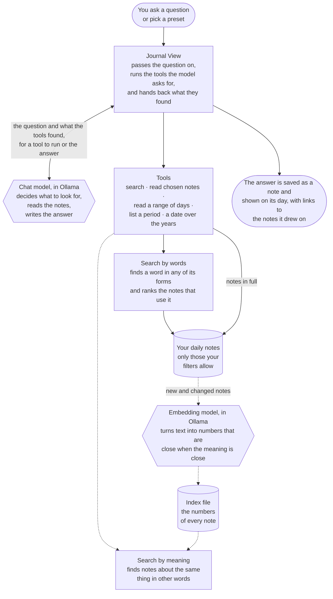
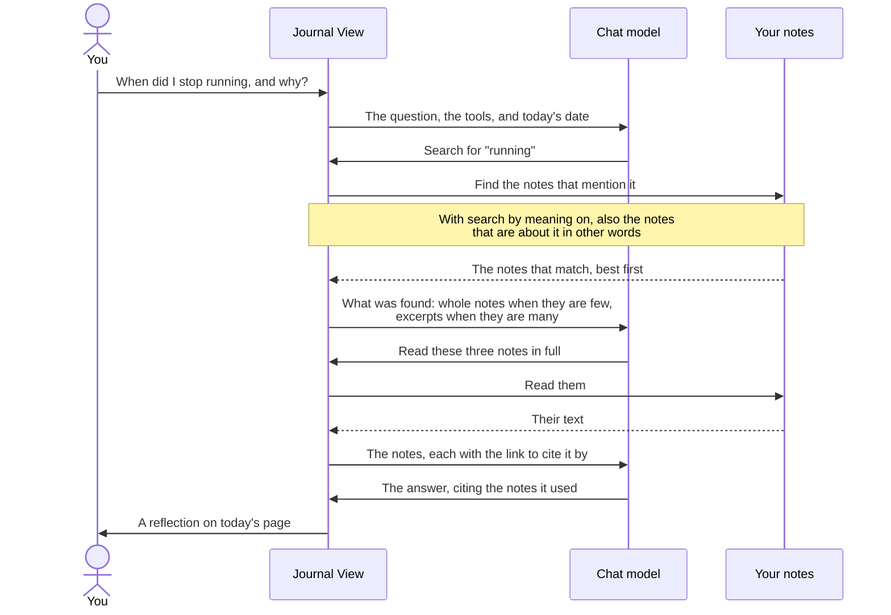

# How Reflection works

A picture of what happens between asking a question and reading the answer. For how to use
Reflection, see [the guide](guide.md#reflections); for why it is built this way, see
[the plan](plans/reflection.md).

Everything below runs on your own computer. The two models are served by Ollama, and nothing else
is contacted.

## The parts

Solid lines are always there. Dotted lines are search by meaning, which is off until you turn it
on in the Reflect window's settings. The two six-sided boxes are the models; everything else is
the plugin and your files.

## One question, step by step

The model may ask for several tools before it answers, and it stops after a few rounds. The plugin
does not let it answer before it has looked, or from excerpts alone.

## What each part is for

| Part | What it does |
| --- | --- |
| **Chat model** | The one that thinks: it decides what to look for, reads what comes back, and writes the answer. It never sees your whole journal, only what the tools return |
| **Tools** | The only way the model can see your notes. Each one returns a small, chosen part of the journal |
| **Search by words** | Finds a word in any of its forms (`run` finds `running`), ranks the notes, and shows the sentences around each match. When a subject's mentions fall within a short stretch of days, it returns that whole stretch, since what happened is often in a note that never names it |
| **Search by meaning** | Optional. Finds notes that are about what was asked without using its words: a search for exercise finds the days you went running. What it finds is shown to the chat model as candidates to judge, never as fact |
| **Embedding model** | Optional, and much smaller than the chat model. It turns a piece of text into a list of numbers, so two texts can be compared by how close their numbers are. It does not write anything |
| **Index file** | The numbers of every note, kept in the plugin's folder so each note is read by the embedding model once, and again only when it changes |
| **Your filters** | Decide which notes any of this can reach. A note a filter hides is never searched, read, or indexed |
